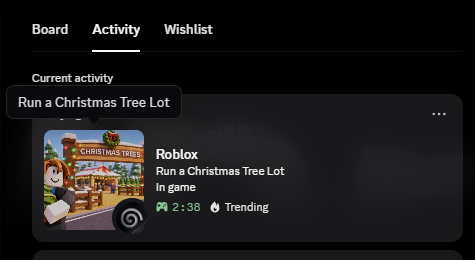

# RBX Presence

Lightweight Windows app that shows the **exact Roblox experience** you're playing on your Discord profile.

No Roblox login, no cookies, no account tokens.  
It just reads local Roblox logs + public APIs.

## Showcase



## Features

- Detects current Place ID / Universe ID from Roblox Player logs
- Fetches experience name + thumbnail from public Roblox endpoints
- Displays game cover as large Discord image
- Shows custom app logo as small image
- Session timer + clickable "View Game" button
- Settings saved locally in `%APPDATA%\RBXPresence`

## Requirements

- Windows 10 / 11
- Python 3.10+ (uniquement pour lancer depuis les sources / compiler l'exe)
- Discord **desktop** app (browser version doesn't support Rich Presence)
- Roblox Player (desktop)

## Quick Start

1. **Create a Discord Application**
   - Go to [Discord Developer Portal](https://discord.com/developers/applications)
   - New Application → copy the **Application ID**

2. **Upload the logo**
   - In your app → **Rich Presence** → **Art Assets**
   - Upload `assets/app_icon.png`
   - Asset key: `rbx_presence` (must be lowercase)

3. **Install & run**

```powershell
py -m pip install -r requirements.txt
py app.py   # ajouter --minimized pour démarrer réduit
```

4. Paste your Application ID → leave asset key as `rbx_presence` → **Save** → **Start monitoring**

## Build executable

```powershell
build.bat
```

Crée un venv propre, puis produit un unique fichier **`dist/RBXPresence.exe`** (sans console).
Sans Windows sous la main : le workflow GitHub Actions `Build Windows exe` (onglet *Actions* → *Run workflow*) compile l'exe pour toi.

## Faible consommation

- Interface en `tkinter` pur (pas de customtkinter / Pillow / requests) → bien moins de RAM que la version CustomTkinter
- Logs Roblox lus de façon **incrémentale** (uniquement les nouveaux octets, plus de relecture de 2 Mo × 5 fichiers)
- Boucle toutes les 5 s, infos du jeu mises en cache, aucune image chargée en mémoire
- Option **Launch with Windows (minimized)** + **Start monitoring when the app opens** : plus rien à faire au quotidien

## Project structure

```
rbx-presence/
├── app.py              # Point d'entrée (instance unique, DPI)
├── src/
│   ├── ui.py           # Interface tkinter
│   ├── controller.py   # Discord RPC + boucle principale
│   ├── roblox.py       # Logs (incrémental) + API Roblox
│   ├── config.py       # Réglages locaux
│   ├── startup.py      # Lancement avec Windows
│   └── paths.py        # Chemins ressources (dev + exe)
├── assets/
│   ├── app_icon.png    # Logo à uploader sur Discord (1024 px)
│   ├── app_icon.svg    # Source vectorielle
│   ├── app_icon.ico    # Icône de l'exe
│   ├── logo_ui.png     # Logo de l'interface
│   └── showcase.png
├── build.bat
└── requirements.txt
```

## Notes

- Only works with the **desktop** Roblox Player
- Log format can change → detection may break after a Roblox update
- Large image = external Roblox thumbnail URL
- Small image = the asset you uploaded (`rbx_presence`)

## License

MIT
